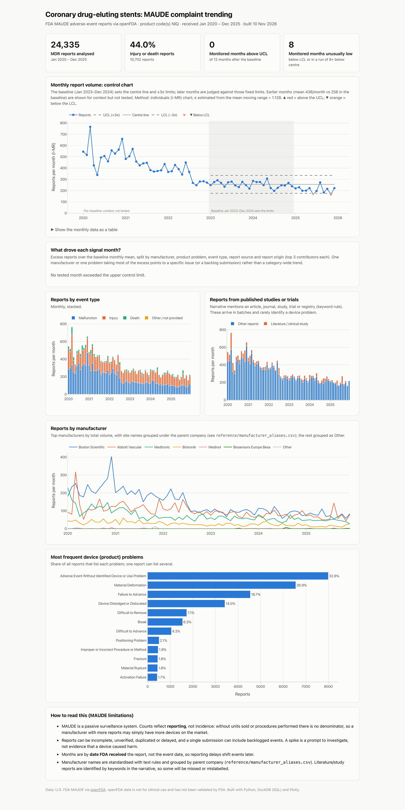
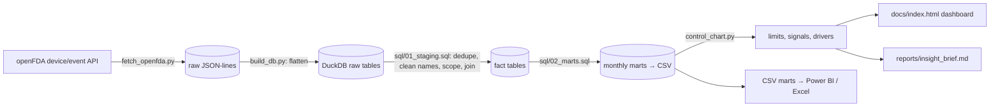

# Medical-Device Complaint Trending: FDA MAUDE


A reproducible complaint-trending pipeline for public FDA **MAUDE** adverse-event reports
(via the [openFDA API](https://open.fda.gov/apis/device/event/)). It pulls every report for a
device category, cleans and joins the data in **SQL**, applies **statistical process control** to
monthly report volumes, breaks down what drove each signal month, and publishes an interactive
dashboard and a one-page insight brief.

Default scope: **coronary drug-eluting stents (FDA product code NIQ)**, reports received
Jan 2020 – Dec 2025. Change one line in `config.yaml` to trend any other device category.

**[▶ Live interactive dashboard](https://YOUR-USERNAME.github.io/maude-complaint-trending/)** ·
**[Insight brief](reports/insight_brief.md)**



## Results

- **24,335** MDR reports for coronary drug-eluting stents (product code NIQ), received
  Jan 2020 – Dec 2025.
- **Report volume fell 61%** (6,362 in 2020 → 2,499 in 2025). Every major manufacturer declined
  (Boston Scientific −68%, Medtronic −65%, Biotronik −60%, Abbott −44%), and 82% of the drop came
  from reports other than those derived from published studies or trials. This points to a
  category-wide change in procedure volumes or reporting practice rather than a single product.
- **No upward signals in 2025.** Against a stable 2023–2024 baseline (centre 256 reports/month,
  UCL 335, LCL 177), no month exceeded the UCL; instead 2025 showed a sustained downward shift
  (−19% vs baseline), with June and November 2025 below the LCL.
- **The largest month, March 2020 (766 reports), coincided with a batch of literature and
  clinical-study reports** (25% of that month vs 15% across 2020), mostly coded as injury or death
  with no identified device problem; this accounts for about half of its excess.
- **Recurring device theme:** delivery-related malfunctions (material deformation in 27% of
  reports, failure to advance in 19%, dislodgement in 14%), mostly in calcified or tortuous
  lesions and usually without patient harm.

Full numbers, method and interpretation: [insight brief](reports/insight_brief.md).

## Why this project

Quality teams trend complaint and adverse-event data to catch emerging issues early: a jump
in one failure mode, one product, or one site. This project rebuilds that workflow on public
data: ingestion, SQL data cleaning, control-chart signal detection, root-cause breakdown, and
reporting to a non-technical reader.

## Pipeline



| Step | What happens |
|---|---|
| **Fetch** | Pages through openFDA one calendar month at a time (1,000 records per request, `skip` pagination, retry with back-off on 429/5xx and network errors). |
| **Clean & join (SQL)** | De-duplicates reports; parses dates; standardises free-text manufacturer names (case, punctuation, legal suffixes) and groups manufacturing-site names under the parent company via an editable alias table; tags reports derived from published articles or clinical studies (narrative keyword rule); keeps only devices with the target product code; builds a complete month spine so zero-report months are not lost. |
| **Control chart** | Individuals (I-MR) chart. A stable baseline window (Phase I, set in `config.yaml`; default Jan 2023 – Dec 2024) fixes the centre line and ±3σ limits; later months (Phase II) are judged against them, and earlier months are shown for context only. Rules, in both directions: a point beyond the UCL/LCL; 8 points in a row on one side of the centre line (sustained shift). |
| **Signal drivers** | For each month above the UCL, splits the excess over baseline by manufacturer, product problem, event type, report source and report origin (literature/study vs other). |
| **Outputs** | Interactive HTML dashboard (GitHub Pages), auto-filled insight brief, narrative samples for the highest-volume and signal months, and CSV marts ready for Power BI or Excel ([build guide and DAX measures](powerbi/POWERBI_GUIDE.md)). |

### Method notes

- **Why I-MR and not a c-chart?** Complaint counts are usually over-dispersed (more variable
  than Poisson), so a c-chart (σ = √mean) produces too many false alarms. I-MR estimates σ from the
  observed month-to-month variation. Set `method: "c"` in `config.yaml` to compare.
- **Why fixed baseline limits?** If limits are recomputed on all data, a sustained rise widens
  its own limits and hides itself.
- **Why a 2023–2024 baseline and not the first months of data?** NIQ report volume fell
  steadily from 2020 to 2022, then levelled off. Limits estimated while the process was changing
  would be far too wide to catch anything later. The baseline should be a stable stretch; check
  the yearly means in the brief and change `baseline_start` / `baseline_end` if you change scope.
- **Date basis:** months use the date FDA *received* the report; `mart_reporting_lag.csv` shows
  how far that lags the event date.

## Quickstart

```bash
git clone https://github.com/YOUR-USERNAME/maude-complaint-trending.git
cd maude-complaint-trending
python -m venv .venv && source .venv/bin/activate   # Windows: .venv\Scripts\activate
pip install -r requirements.txt

python run_pipeline.py            # fetch + build everything (a few minutes)
python run_pipeline.py --skip-fetch   # rebuild from data already downloaded
pytest -q                          # tests run offline on a synthetic fixture
```

Optional: a free [openFDA API key](https://open.fda.gov/apis/authentication/) raises the rate
limit: `export OPENFDA_API_KEY=...` (Windows: `set OPENFDA_API_KEY=...`).

**Publish the dashboard:** push to GitHub, then *Settings → Pages → Deploy from a branch →
`main` / `docs`*.

## Repository layout

```
config.yaml               scope (product codes, dates) and control-chart settings
run_pipeline.py           runs every step
src/fetch_openfda.py      openFDA download
src/build_db.py           JSON → DuckDB, runs SQL, exports marts
src/sql/01_staging.sql    cleaning, de-duplication, scoping, joins
src/sql/02_marts.sql      monthly marts, problem frequencies, reporting lag
src/control_chart.py      I-MR / c-chart limits, run rules, signal drivers
src/make_dashboard.py     docs/index.html
src/make_brief.py         reports/insight_brief.md + narrative samples
reference/                manufacturer alias table (site name → parent company)
powerbi/                  Power BI build guide and DAX measures
tests/                    synthetic fixture + pytest suite
data/marts/               analysis-ready CSVs (committed); raw data is git-ignored
```

## Limitations

- **Reporting, not incidence.** MAUDE is passive surveillance with no denominator (units sold,
  procedures). A manufacturer with more reports may simply have a larger market share.
- Reports can be incomplete, unverified, duplicated or delayed; a single submission can contain
  backlogged events, which shows up as a spike.
- Manufacturer-name standardisation is rule-based; grouping sites under a parent company is a
  choice recorded in `reference/manufacturer_aliases.csv`.
- Literature/study reports are identified by keywords in the narrative, so the split is approximate.
- A control-chart signal is a prompt to investigate, not evidence that a device caused harm.

## Author

**Mihir Chachar**. Pharm.D; MSc Biomedical Genomics, University of Galway.

## Data & disclaimer

Data: U.S. Food and Drug Administration, MAUDE, accessed via openFDA. openFDA notes that its
data is not for clinical use and has not been validated by FDA. This is an independent portfolio
project, not affiliated with FDA or any manufacturer.

## License

MIT. See [LICENSE](LICENSE).